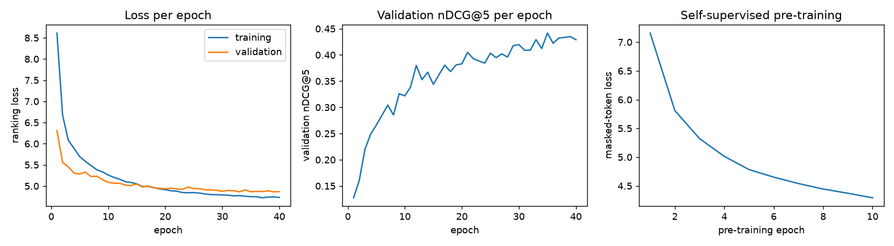
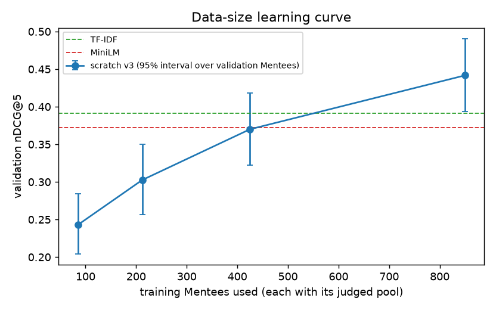

# From-scratch model, version 3 · 17 November 2026

**Issues #25 (training), #3 (evaluation), #26 (live comparison). Synthetic data, generated labels, machine
audit only. Not human-reviewed. Supervisor acceptance still needed.**

On the locked synthetic test split the scratch v3 model scores nDCG@5 0.337 (95% interval 0.298 to 0.376), against 0.271 for frozen MiniLM, 0.332 for TF-IDF and 0.042 for random ordering. By the paired bootstrap it is better than MiniLM (difference +0.066, interval 0.020 to 0.112) and not distinguishable from TF-IDF (difference +0.005, interval -0.041 to 0.051). On test Mentees aiming for occupations from clusters never seen in training it is worse than MiniLM (-0.076, interval -0.150 to -0.002) and worse than TF-IDF (-0.169, interval -0.239 to -0.103).

nDCG@5 was declared the primary metric in the lock. On the secondary metrics MRR@5 and P@1 the scratch model is ahead of TF-IDF (+0.076, interval 0.0005 to 0.1517; +0.106, interval 0.017 to 0.194); the MRR@5 interval only just excludes zero and six metrics were examined, so this is weak evidence and is not claimed as a win over TF-IDF.

What this does and does not show:

- The benchmark is **synthetic and in-domain**. The scratch model was trained on profiles produced by the
  same generator, writer and grading rule as the test profiles. That favours a model trained on it over a
  general-purpose pretrained model such as MiniLM, which never saw the rule.
- **Labels are generated by a rule and are not human-reviewed.** An independent machine judge agreed with
  them only moderately (weighted kappa 0.67).
- A synthetic-only test **cannot establish performance on real alumni**. The missing independent checks are
  the human review sheet (issue #115) and evaluation with real users (#5).
- The test split was opened once, after a committed lock. Nothing was changed afterwards.
- Every parameter was trained from random initialisation. No pretrained weights, vocabularies or embeddings
  were used and nothing was distilled from MiniLM.

Sections follow the lecturer's evidence list: problem and baseline, data, split design, system design,
implementation, experiments, evaluation, limitations and responsible use, supervisor review still needed.

## 1. Problem and baseline

**Task.** Given a Mentee's profile (headline, bio, skills, industry), rank the Mentor profiles so that the
most suitable Mentors come first. Suitability is graded 0 to 3 with the rubric in `ml-next-steps.md`.

**Why a third attempt.** v1 (a character CNN) and v2-A (a bag encoder) were trained on 60 machine-graded
pairs with 3-candidate pools and judged on 5 validation Mentees. Both scored below TF-IDF, and v2-A gave
every Mentee almost the same Mentor order (see `ml-scratch-v2.md`, `ml-gbdt-ranker.md`). The changes here
are data scale, training pools that look like use, a ranking loss, and a collapse check that must pass
before a metric is read.

**Baselines**, all scored by the same evaluator (`ml/eval_v3.py`) on the same complete pools:

- Random ordering, mean of 100 seeds: the floor.
- TF-IDF over character 3 to 5 grams, fitted on training profiles only: the baseline earlier models lost to.
- BM25 over words, statistics from training profiles only.
- MiniLM (`Xenova/all-MiniLM-L6-v2`, 8-bit) exactly as deployed: vectors come from a Node script that
  imports `lib/embedding/embed.ts` and joins the same four fields as the comparison route.

| Validation (150 Mentees, pool of 300) | nDCG@5 | nDCG@10 | MRR@5 | P@1 | P@5 | hit@5 | nDCG@5 95% interval |
| --- | ---: | ---: | ---: | ---: | ---: | ---: | --- |
| Random (mean of 100 seeds) | 0.049 | 0.058 | 0.060 | 0.027 | 0.028 | 0.128 | |
| TF-IDF, character 3 to 5 grams | 0.391 | 0.397 | 0.479 | 0.378 | 0.225 | 0.638 | 0.348 to 0.435 |
| BM25 | 0.358 | 0.363 | 0.461 | 0.323 | 0.230 | 0.685 | 0.316 to 0.401 |
| MiniLM (frozen, as deployed) | 0.372 | 0.385 | 0.447 | 0.299 | 0.233 | 0.677 | 0.331 to 0.415 |
| Scratch v3, locked checkpoint | 0.442 | 0.465 | 0.522 | 0.394 | 0.365 | 0.724 | 0.393 to 0.490 |

Validation was used for selection, so the scratch row above is optimistic by construction. The test
results are in section 7. nDCG is undefined for a Mentee whose pool has no grade above 0, and the yes or no
metrics are undefined for a Mentee with no Mentor of grade 2 or 3; those Mentees are left out of that
metric's mean (143 and 127 of the 150 validation Mentees remain).

## 2. Data

The full record is the [data card](ml-synth-v3-data-card.md). In brief:

- **Source of structure:** O*NET 30.2 (CC BY 4.0): 171 occupations a Mentor can hold, weighted towards
  aviation, logistics, engineering and management in East Africa, with tasks, tools and related-occupation
  links.
- **People:** 2,400 fictional Mentors and 1,200 fictional Mentees, each sampled as a hidden specification.
- **Grades:** a deterministic rule over the two specifications (occupation proximity, whether the Mentor
  offers the help the Mentee wants, shared skills). It never reads the text and never calls a model.
- **Wording:** written by Claude Haiku from briefs that show no grade, identifier or other side of a pair.
  Cases: standard, vocabulary mismatch (the occupation is never named), sparse cold-start profiles, career
  changers, and Mentees with no suitable Mentor.
- **Checks:** a validation gate (schema, length, duplicates, label and specification leakage, named
  organisations, split disjointness). It rewrote 72 profiles and blocked one real cross-split leak, which
  was fixed before any model was trained. Nothing was dropped.
- **Machine audit (not human review):** on 300 grade-balanced pairs an independent judge matched the rule
  exactly on 51%, within one grade on 91%, weighted kappa 0.67. The labels are noisy
  relative to what the text alone supports.

## 3. Split design

| Split | Mentors | Mentees | Judged pairs | Use |
| --- | ---: | ---: | ---: | --- |
| Train | 1,700 | 850 | 39,416 sampled pairs, plus the complete 850 by 1,700 grade matrix | Fitting weights, tokeniser and all preprocessing |
| Validation | 300 | 150 | 45,000 (complete) | Early stopping, grid comparison, selection |
| Test | 400 | 200 | 80,000 (complete) | Scored once after the lock |

- No person appears in two splits.
- 16 occupation clusters (SOC minor groups) appear only in test and 11 only in validation, in any role.
  Test Mentees aiming for them form the unseen-occupation subset.
- Test profiles were written with a different prompt template and different style instructions.
- Tokeniser, vocabulary, TF-IDF and BM25 statistics are fitted on training text only.
- Trainers and the baseline script refuse to open any `test_*` file. Only `ml/score_locked_test_v3.py` reads
  them, and only when `LOCK.json` is committed and matches the checkpoint and the test files.
- The old `pilot-machine-v1` test split is still unopened.

## 4. System design

```
profile fields (headline, bio, skills, industry)
      |  joined exactly as the comparison route joins them
      v
byte-pair tokeniser (3,000 pieces, learned from training text only)
      |  up to 160 token ids
      v
encoder from random weights (convolutional or Transformer)
      |  learned weighted average of token features
      v
centring across profiles, one set of statistics per role
      |
      +--> Mentee head (no bias) --> 64 values, length 1   (query vector)
      +--> Mentor head (no bias) --> 64 values, length 1   (Mentor vector)

score(Mentee, Mentor) = dot product of the two vectors (cosine similarity)
```

**Directional task.** The question is always "which Mentors suit this Mentee", so the two sides get different
heads on a shared encoder. A Mentee vector is only ever compared with Mentor vectors.

**Tokeniser.** Byte-pair encoding implemented in `ml/bpe_tokenizer.py` and learned from the training
profile text of each run. Only ASCII letters are lower-cased and only ASCII white space splits words, so the
Python trainer and the Node application cannot disagree about Unicode rules. The same file,
`tokenizer.json`, is used for training and serving.

**Loss.** A graded listwise (softmax) ranking loss. A training batch holds 16 Mentees and the Mentors sampled
for them in the pair file (graded positives and hard negatives). Every Mentor in the batch is a candidate
for every Mentee in the batch, with its true grade looked up in the complete training grade matrix, so a
batch supplies several hundred correctly labelled negatives per Mentee. The target for a Mentee puts weight
on each candidate in proportion to the gain `2^grade - 1` (grade 3 counts 7, grade 2 counts 3, grade 1 counts
1, grade 0 counts 0). No ungraded pair is ever used as a negative.

**What stops the v2 collapse.** v2-A gave every Mentee the same Mentor order. Three design choices address
that, and one check verifies it:

1. Pooled features are centred and scaled across profiles before the heads, separately for Mentees and
   Mentors (batch normalisation without learned scale or offset). After centring, Mentee vectors no longer
   share one dominant direction, so the Mentor side cannot lower the loss by simply scoring popular Mentors
   highly for everyone.
2. The heads have no biases.
3. Both heads start from the same random matrix, then train separately. From the first step, the same
   wording on both sides already counts as similar.
4. The collapse diagnostic (share of score variance explained by each Mentor's average score, after
   removing each Mentee's mean) is computed after every epoch. An epoch's validation metrics are recorded
   only if the share is at or below 0.5. For reference, TF-IDF, BM25 and MiniLM score 0.20 to 0.23 on the
   validation pool.

**Optional self-supervised pre-training.** Masked-token prediction on training profile text only, for 10
epochs, starting from the same random weights: 15% of tokens are hidden and the model predicts them. It
uses no labels and no outside text, and it is a grid factor (on or off), reported as such.

**What "from scratch" means here.** Every parameter starts from PyTorch's seeded random initialisation.
No pretrained weights, vocabularies or embeddings are loaded anywhere in `ml/train_scratch_v3.py`. Nothing is
distilled from MiniLM, and MiniLM never labelled, filtered, mined negatives for or selected anything; it is
only scored as a reference system by the same evaluator.

## 5. Implementation

| Item | Selected model |
| --- | --- |
| Encoder | conv (kernel sizes 1, 3 and 5 over token embeddings, then a linear mix), width 128 |
| Self-supervised pre-training | yes: masked-token prediction on training text, 10 epochs |
| Tokeniser | Byte-pair encoding, 3,000 pieces, up to 160 tokens per profile |
| Pooling and heads | Learned weighted average; per-role centring; two bias-free linear heads to 64 values; L2 normalised |
| Trainable parameters | **597,632** (all trainable, all randomly initialised; the masked-token output bias used only in pre-training is not counted) |
| Loss | Graded listwise softmax over in-batch candidates, logit scale 16 |
| Optimiser | AdamW, learning rate 0.002 with 50 warm-up steps then cosine decay, weight decay 0.01, gradient clipping at 1.0 |
| Batch | 16 Mentees and every Mentor sampled for them (several hundred) |
| Regularisation | Dropout 0.1; 10% of input tokens replaced by a mask token |
| Epoch budget and stopping | Up to 40 epochs; stop after 8 epochs without a better validation nDCG@5; 24 minute cap per run |
| Checkpoint rule | Keep the epoch with the highest validation nDCG@5 among epochs that pass the collapse check |
| Seed of the locked model | 42 |
| Environment | Python 3.14.7, PyTorch 2.15.0, NumPy 2.5.4, Apple MPS, macOS-27.0.1-arm64-arm-64bit-Mach-O |
| Code | `ml/train_scratch_v3.py` at commit `6508376`. The run record flags the ml folder as not clean: an untracked development export folder and two untracked helper scripts were present. No tracked file differed from the commit, and the trainer does not import those files |
| Exported artefact | `ml/models/scratch-v3/encoder.onnx`, 2.29 MB, SHA-256 `8c918ddf78e3…` |

Tests in `ml/training_tests/test_scratch_v3.py` show that a fixed seed gives identical weights, that changing
validation grades changes no weight at any epoch, that no test file is opened, and that a saved model
reloads to identical vectors.

## 6. Experiments

### Smoke tests before the grid (training data only)

Before any validation file was read, short smoke tests were run on a development split carved out of the
training data (120 training Mentees and 300 training Mentors held back). They are development work, not
results, and are listed because they shaped the fixed settings:

| Smoke test (training-only split) | What was seen | Change made |
| --- | --- | --- |
| First design: layer normalisation after pooling, pairwise loss inside each sampled pool | Both encoders collapsed: 90% to 100% of score variance came from the Mentor's average score, the v2-A failure again | Pooled features centred per role (batch normalisation without learned scale or offset) |
| With centring | Collapse share fell to 0.05 to 0.15, but nDCG@5 was about half of TF-IDF on that split. Sampled pools held too few easy negatives compared with a full pool | Complete training grade matrix written by the generator, so every Mentor in a batch is a candidate with its true grade |
| Listwise against pairwise loss | Similar (0.24 and 0.23 for the convolutional encoder after 8 epochs) | Listwise kept: one fixed choice, cheaper to compute |
| Both heads starting from the same random matrix; attention pooling | Small gains each (about 0.01 to 0.02) | Kept |
| Learning rates 0.001 and 0.005 against 0.002 | No gain | 0.002 kept |
| 40 epochs instead of 8 | Large gain: the convolutional encoder at width 128 reached 0.44 against TF-IDF 0.33 on that split and was still improving at epoch 20 | Epoch budget 40, patience 8 |

These choices were made on training data. The development split shares people with the final training set,
so its figures are not results and are not reported as such.

### Grid, fixed and committed before the first run

Encoder (Transformer or convolutional) by width (64 or 128) by self-supervised pre-training (off or on):
eight configurations, each trained once with seed 42. The two best by validation nDCG@5 are finalists and
are trained with seeds 42, 43 and 44. The configuration with the higher mean is selected and its best seed
is locked. All eight are shown, losers included.

| Encoder | Width | Pre-training | Parameters | nDCG@5, seed 42 | Best epoch | Collapse share | Minutes | All seeds | Mean over seeds |
| --- | ---: | --- | ---: | ---: | ---: | ---: | ---: | --- | --- |
| conv | 128 | yes | 597,632 | 0.442 | 35 | 0.030 | 7.3 | 42: 0.442, 43: 0.384, 44: 0.431 | 0.419 (sd 0.030) |
| conv | 128 | no | 597,632 | 0.432 | 24 | 0.033 | 5.6 | 42: 0.432, 43: 0.423, 44: 0.395 | 0.417 (sd 0.019) |
| transformer | 128 | no | 685,952 | 0.368 | 33 | 0.027 | 24.6 |  |  |
| conv | 64 | yes | 249,664 | 0.352 | 17 | 0.020 | 2.2 |  |  |
| transformer | 128 | yes | 685,952 | 0.343 | 34 | 0.041 | 24.3 |  |  |
| conv | 64 | no | 249,664 | 0.340 | 31 | 0.017 | 4.1 |  |  |
| transformer | 64 | no | 277,440 | 0.305 | 25 | 0.041 | 14.0 |  |  |
| transformer | 64 | yes | 277,440 | 0.299 | 40 | 0.028 | 16.4 |  |  |

Selected: **conv-w128-pre**, mean validation nDCG@5 0.419 over three seeds (standard deviation
0.030); locked seed 42 with 0.442. The other finalist, conv-w128-nopre, had mean 0.417 (standard deviation 0.019).

Reading the grid:

- **Width mattered most.** Width 128 beat width 64 for both encoders.
- **The convolutional encoder beat the Transformer** at both widths on this amount of data, and trained four
  to five times faster. The two wide Transformer runs stopped at the 24 minute cap (35 and 34 of 40 epochs),
  so they may be slightly under-trained; that is a limit of the budget, recorded here rather than removed.
- **Pre-training made no reliable difference.** With seed 42 it helped the convolutional encoder a little and
  hurt the Transformer a little. Over three seeds the two finalists differ by 0.002 in mean, far less than
  the spread between seeds. The rule selected the pre-trained one; the honest reading is a tie.
- Every run passed the collapse check at its kept epoch (shares 0.02 to 0.04).

### Curves for the locked run



Training loss fell from 8.612 to 4.731 over 40 epochs; validation loss from 6.309 to 4.863 at
its lowest. The kept epoch is 35 (validation nDCG@5 0.442, collapse share 0.030).
Both losses fall throughout. The training loss drops below the validation loss at about epoch 17 and the gap
then widens slowly, which is the model starting to fit the training people more closely than new ones.
Validation nDCG@5 was 0.405 at epoch 21 and 0.442 at epoch 35, so later epochs still helped a little. The run
ended at the 40 epoch budget rather than by early stopping, so a longer budget might have gained slightly more.

### Repeated-run variability

Across seeds 42, 43 and 44 the selected configuration scored 0.442, 0.384, 0.431 on validation
(standard deviation 0.030). Differences between configurations smaller than about that size
should not be read as real. Runs on Apple MPS are not bit-for-bit repeatable; on CPU they are (tested).

### Data-size learning curve

The selected configuration was retrained on 10%, 25% and 50% of the training Mentees (each with its judged
pool; the tokeniser is refitted on the reduced text), seed 42, same validation pool. The 100% point is the
seed 42 run of the selected configuration.

| Share of training Mentees | Mentees | Sampled pairs | Validation nDCG@5 | 95% interval | Best epoch |
| --- | ---: | ---: | ---: | --- | ---: |
| 10% | 85 | 3,941 | 0.243 | 0.204 to 0.285 | 39 |
| 25% | 212 | 9,736 | 0.303 | 0.257 to 0.350 | 21 |
| 50% | 425 | 19,734 | 0.370 | 0.322 to 0.418 | 38 |
| 100% | 850 | 39,416 | 0.442 | 0.393 to 0.490 | 35 |



Validation nDCG@5 rises with every doubling of the training data (about +0.06 to +0.07 each time) and has
not flattened at 850 Mentees. More data of the same kind would very probably help, which also means the
current model is limited by data, not only by its design. One seed per point, so each point carries the
seed-to-seed spread of about 0.03.

### Computing budget

All training ran on one laptop (Apple MPS). Total training time across the grid, the extra finalist seeds
and the learning-curve runs was about 126 minutes; the longest single run took 24.6 minutes
(limit 25). Writing the synthetic profiles cost about $2.23 in Claude Haiku usage.

## 7. Evaluation

### Lock and single use of the test split

`LOCK.json` (checkpoint SHA-256 `fec862f8d00b…`, configuration, data manifest hash, protocol) was committed
in `b69d5f1` before the test split was read. The scorer checked the lock, the checkpoint, the
tokeniser and the three test files against their recorded hashes, scored every system once and wrote
`ml/runs/v3-grid-conv-w128-pre-s42/test/`. It refuses to run again. No model, setting or protocol change was made
afterwards. **Disclosure of test reuse: none.**

### Test size and composition

200 Mentees, each ranked against all 400 test Mentors (80,000 judged pairs: grade 0 70,229, grade 1 7,767, grade 2 1,606, grade 3 398).
nDCG is defined for 190 Mentees and the yes or no metrics for 180. Tags (they overlap): career changer 40, no suitable mentor 20, seen occupation 124, sparse 41, unseen occupation 72, vocabulary mismatch 38.

### Results

| Test (200 Mentees, pool of 400) | nDCG@5 | nDCG@10 | MRR@5 | P@1 | P@5 | hit@5 | nDCG@5 95% interval |
| --- | ---: | ---: | ---: | ---: | ---: | ---: | --- |
| Random (mean of 100 seeds) | 0.042 | 0.050 | 0.061 | 0.030 | 0.027 | 0.125 | |
| TF-IDF | 0.332 | 0.340 | 0.418 | 0.278 | 0.221 | 0.628 | 0.298 to 0.367 |
| BM25 | 0.308 | 0.311 | 0.425 | 0.289 | 0.213 | 0.644 | 0.274 to 0.344 |
| MiniLM (frozen, pretrained) | 0.271 | 0.292 | 0.362 | 0.239 | 0.188 | 0.594 | 0.242 to 0.303 |
| Scratch v3 | 0.337 | 0.377 | 0.494 | 0.383 | 0.316 | 0.678 | 0.298 to 0.376 |

| Difference | Metric | Mean | 95% interval | Mentees | Reading |
| --- | --- | ---: | --- | ---: | --- |
| Scratch v3 minus MiniLM | nDCG@5 | +0.066 | 0.020 to 0.112 | 190 | Scratch v3 is better |
| Scratch v3 minus MiniLM | MRR@5 | +0.132 | 0.056 to 0.208 | 180 | Scratch v3 is better |
| Scratch v3 minus MiniLM | P@1 | +0.144 | 0.056 to 0.233 | 180 | Scratch v3 is better |
| Scratch v3 minus TF-IDF | nDCG@5 | +0.005 | -0.041 to 0.051 | 190 | not distinguishable |
| Scratch v3 minus TF-IDF | MRR@5 | +0.076 | 0.0005 to 0.1517 | 180 | Scratch v3 is better |
| Scratch v3 minus TF-IDF | P@1 | +0.106 | 0.017 to 0.194 | 180 | Scratch v3 is better |
| Scratch v3 minus BM25 | nDCG@5 | +0.029 | -0.016 to 0.072 | 190 | not distinguishable |
| Scratch v3 minus BM25 | MRR@5 | +0.069 | -0.006 to 0.141 | 180 | not distinguishable |
| Scratch v3 minus BM25 | P@1 | +0.094 | 0.011 to 0.178 | 180 | Scratch v3 is better |

"Better" and "worse" are written only where the paired 95% interval excludes zero.

### Subgroup results (nDCG@5)

| Subset | Mentees (with defined nDCG) | TF-IDF | BM25 | MiniLM | Scratch v3 | v3 minus MiniLM, nDCG@5 | v3 minus TF-IDF, nDCG@5 |
| --- | ---: | ---: | ---: | ---: | ---: | --- | --- |
| All test Mentees | 200 (190) | 0.332 | 0.308 | 0.271 | 0.337 | +0.066 (0.020 to 0.112): Scratch v3 is better | +0.005 (-0.041 to 0.051): not distinguishable |
| Seen occupation | 124 (124) | 0.316 | 0.300 | 0.271 | 0.412 | +0.141 (0.088 to 0.195): Scratch v3 is better | +0.096 (0.041 to 0.150): Scratch v3 is better |
| Unseen occupation (held-out clusters) | 72 (65) | 0.370 | 0.329 | 0.276 | 0.200 | -0.076 (-0.150 to -0.002): Scratch v3 is worse | -0.169 (-0.239 to -0.103): Scratch v3 is worse |
| Vocabulary mismatch | 38 (37) | 0.205 | 0.235 | 0.206 | 0.281 | +0.075 (-0.022 to 0.174): not distinguishable | +0.076 (-0.006 to 0.161): not distinguishable |
| Sparse (cold start) | 41 (37) | 0.392 | 0.367 | 0.296 | 0.425 | +0.129 (-0.002 to 0.256): not distinguishable | +0.033 (-0.091 to 0.153): not distinguishable |
| Career changer | 40 (40) | 0.219 | 0.232 | 0.216 | 0.288 | +0.072 (-0.035 to 0.180): not distinguishable | +0.068 (-0.034 to 0.171): not distinguishable |
| No suitable Mentor (best grade 0 or 1) | 20 (10) | 0.306 | 0.300 | 0.106 | 0.139 | +0.033 (-0.092 to 0.153): not distinguishable | -0.168 (-0.333 to -0.026): Scratch v3 is worse |

Reading the subgroups:

- **Seen occupations (124 Mentees): scratch v3 is better than both MiniLM and TF-IDF.** This is where
  training on the dataset pays: the model has learned which jobs go together and how offers of help are worded.
- **Unseen occupations (72 Mentees, 65 with a defined nDCG): scratch v3 is worse than both.** For occupation
  clusters absent from training it has no knowledge to fall back on, while TF-IDF still matches shared word
  pieces and MiniLM brings general language knowledge. This is the clearest warning about real use, where
  new job titles are normal.
- **Vocabulary mismatch, sparse profiles and career changers:** scratch v3 has the highest mean in each, but
  none of the differences is distinguishable with 37 to 40 Mentees.
- **No suitable Mentor:** only 10 of these 20 Mentees have any Mentor above grade 0, so nDCG is defined for
  10. The scratch model is worse than TF-IDF there. No system has a way to say "nobody suitable"; each
  simply returns its top five. That behaviour is not measured by any metric here and is a gap.

### Representative errors

Counting the first result returned for each of the 180 test Mentees who have a relevant Mentor: for 69 the
top result was relevant (grade 2 or 3); for 65 it offered the right kind of help in the wrong field; for 17
it was in the right or a linked field but offered a different kind of help; for 29 it was neither. The
commonest mistake is therefore matching on the kind of help and missing the field.

Examples (fictional profiles, headlines shortened):

1. **Unseen occupation, total miss.** Mentee: "Career changer aiming for fraud investigation ... moving from
   production planning into investigations" (sparse profile, target cluster never seen in training). Scratch
   v3 returned a logistics analyst "who moved up from production planning", a supply chain director
   "coaching career changers" and a shipping team lead: it latched onto the Mentee's current field and the
   words about changing career. The grade 3 Mentor was at rank 49. MiniLM and TF-IDF both put it first.
2. **Unseen occupation, right help, wrong field.** Mentee: a final-year student who "wants to be a landscape
   architect" and is asking about qualifying. Scratch v3 returned a regulatory affairs leader, a financial
   adviser and an auditor. The best Mentor was at rank 33 (TF-IDF rank 2, MiniLM rank 3).
3. **Vocabulary mismatch on a seen occupation, hard for everyone.** Mentee: a student "turning site plans into
   precise technical drawings" (civil engineering technology, never named). Scratch v3 put the grade 3 Mentor
   at rank 22, behind a records manager and a mapping specialist. MiniLM had it at rank 250 and TF-IDF at
   rank 375, so here the trained model was least wrong.
4. **Right field, wrong kind of help.** Mentee: a student aiming for cabin crew work who wants to set up
   independently. The top three were all flight attendants offering technical coaching (grade 1 each); the
   Mentor offering advice on starting a business was at rank 10.
5. **A success the baselines missed.** Mentee: "Lecturer turning to pay and benefits" (sparse, career changer).
   Scratch v3 ranked first the pay and benefits director who helps people switch into that work (grade 3).
   TF-IDF had that Mentor third and MiniLM nineteenth.

Some disagreements will be label noise: the rule gave grade 1 to same-occupation Mentors who do not list the
exact kind of help, which a human reader might well grade higher.

### Practical performance

| Measure | Value |
| --- | --- |
| Model file | 2.29 MB ONNX (limit 25 MB), tokeniser file 106 KB |
| Python and Node agreement | Largest difference on the parity fixtures 1.8e-7 (tolerance 1e-4) |
| Collapse share on test | 0.052 (TF-IDF 0.256, MiniLM 0.297) |
| Response time | See section 10 |

### Legacy reference (tiny five-query set, for continuity only)

The old `pilot-machine-v1` validation pools: 5 Mentees by 10 Mentors, unreviewed machine labels from a
different generator, already used to compare earlier models. Metrics use the earlier convention.

| System | nDCG@5 | P@1 | MRR@5 | hit@5 |
| --- | ---: | ---: | ---: | ---: |
| random (mean of 100 seeds) | 0.325 | 0.136 | 0.276 | 0.568 |
| TF-IDF | 0.854 | 0.800 | 0.840 | 1.000 |
| v1 character CNN | 0.502 | 0.200 | 0.433 | 0.800 |
| GBDT ranker | 0.615 | 0.400 | 0.567 | 0.800 |
| v2-A bag encoder (mean of 5 seeds) | 0.301 | 0.080 | 0.244 | 0.560 |
| v2-B reweighted TF-IDF | 0.863 | 0.800 | 0.850 | 1.000 |
| **Scratch v3 (locked)** | 0.704 | 0.400 | 0.667 | 1.000 |

On this tiny set the locked v3 model scores above v1, the GBDT ranker and v2-A and below TF-IDF and v2-B.
The profiles come from a different generator and five Mentees cannot separate systems, so this is continuity
evidence only. It does show the model is not useless outside its own dataset, and that it does not collapse
there (collapse share 0.23).

## 8. Limitations and responsible use

A synthetic-only test cannot establish performance on real alumni. The independent checks that are missing
are the human review sheet (`ml/data/synth-v3/human_review_sheet.csv`, 40 test Mentees with 8 candidates
each, issue #115) and evaluation with real users (#5).

| Synthetic-data risk | What it means here | What was done | What remains |
| --- | --- | --- | --- |
| Inherited errors | The grading rule, O*NET's United States view of occupations and the writer's habits are built into both training and test data. A model can score well by learning those habits. | Rule documented and unit-tested; blind machine audit; test prompt template and styles differ from training | Human review of grades; real profiles |
| Limited diversity | One writer model, 26 styles, 7 kinds of goal, 171 Mentor occupations | Sparse, vocabulary-mismatch, career-changer and no-suitable-Mentor cases; held-out occupation clusters | Real wording is messier, multilingual and less complete |
| Easier than reality | Each profile was written from a brief that states the person's job and what they offer or want | Hard negatives; the unseen-occupation and mismatch subsets are reported separately | Real goals are often unstated or mixed |
| Contamination | Test data leaking into training would inflate the score | People, held-out clusters, styles and the test template are disjoint and checked in code; the gate blocked one real leak; fitted preprocessing uses training text only; the test was scored once after a committed lock | The writer model and the seen occupations are shared across splits, so the test is in-domain |

Other limits:

- **Generated labels.** The machine audit found only moderate agreement between the rule and an
  independent reading of the text. Some "errors" of every system are label noise.
- **Validation was used for selection** and for early stopping, so validation figures for the scratch model
  are optimistic. Only the test figures are held out.
- **One dataset, one generator.** There is no second benchmark. The five-query legacy set is far too small to serve as one.
- **Small model, short text.** Profiles are truncated at 160 tokens.
- **Not a fairness or safety evaluation.** No protected characteristic is generated, used or measured.
- **Responsible use.** In the application the model is shown only in the experimental side-by-side
  comparison, labelled as experimental with its version. It does not drive the default Recommended list, no
  stored vector was migrated and no production data changed. It should not be used to make decisions about
  real members without human review of labels and a real-user evaluation.

**What is claimed:** a model trained from random weights learned the ranking task defined by this synthetic
dataset, with the results above. **What is not claimed:** that it is better than MiniLM or TF-IDF for real
alumni, that the labels match human judgement, or that the result will transfer.

## 9. Supervisor review still needed

- Whether this protocol and synthetic dataset are acceptable as the research evidence for #25 and #3.
- Human grading of the blind review sheet (#115), then rescoring every system on the reviewed grades.
- Whether the comparison-only integration satisfies #26 for the assessed release, or whether the scratch
  model must drive the default list (which needs a stored-vector migration that was out of scope here).
- Real-user evaluation (#5).

## 10. Serving evidence

| Item | Evidence |
| --- | --- |
| Version and checksum shown | The comparison column header shows `scratch-v3:8c918ddf78e3` (model id and the first 12 hex digits of the ONNX SHA-256). Full SHA-256: `8c918ddf78e3a54503215db2bfae2f52cd83f024233105a6f002d2513595ff71`. Tokeniser SHA-256: `20ad3b6a94b26f3f1f78d22887701a21b82cfcbbf48a59544931246d8c8f34a0`. Both files are hash-checked when loaded. |
| Response times | Local machine (Apple silicon laptop), production build (`next start`), 24 requests to `POST /api/match/compare` from 12 disposable accounts, pool of 5 seeded Mentors: scratch model median 10 ms, 95th percentile 13 ms, maximum 18 ms; first request after server start 68 ms including model loading. MiniLM on the same requests: median 26 ms, 95th percentile 31 ms. Whole HTTP request: median 51 ms, 95th percentile 62 ms, first 205 ms. Model alone on a full batch of 51 profiles (the route's maximum), 30 runs: median 33 ms, maximum 34 ms, first call 53 ms. Hosted timings were not measured. |
| Missing or altered model file | The loader checks the SHA-256 of `tokenizer.json` and `encoder.onnx` against the manifest before use. A missing file or a changed byte raises an error (`lib/scratch-model.test.mjs` tests both). In the route each model is isolated: the scratch column then shows "Your trained model (v3) is unavailable. Please retry the comparison." while the MiniLM column still shows its results, and the failed load is retried on the next request. No other model is substituted silently. |
| No hub access | The tokeniser and model are read from `ml/models/scratch-v3/` on local disk. Nothing is downloaded for the scratch model. |
| Screenshot | `docs/verification/ml-scratch-v3/model-comparison-v3-desktop.png` and `-mobile.png` |

### Traceability

Objectives are paraphrased from the approved proposal as recorded in `proposal-traceability.md` and
`scratch-model-requirements.md`.

| Objective | Component | Test | Result | Evidence |
| --- | --- | --- | --- | --- |
| Train a matching model from scratch | `ml/train_scratch_v3.py`, `ml/bpe_tokenizer.py` | `test_scratch_v3.py` (random start only, determinism, reload) | 597,632 parameters trained from random weights; falling loss; passes the collapse check | Section 5 and 6; run record `v3-grid-conv-w128-pre-s42` |
| Use open taxonomy and synthetic data, no personal data | `ml/synth/` | `test_synth_dataset.py` | 3,600 fictional profiles, gate passed, one leak blocked and fixed | Data card |
| Evaluate ranking quality against baselines (random, TF-IDF, BM25, MiniLM) with nDCG@5, MRR@5, P@5 | `ml/eval_v3.py`, `ml/baselines_v3.py`, `ml/score_locked_test_v3.py` | `test_eval_v3.py` (hand-computed cases) | Test nDCG@5 0.337 against 0.332 (TF-IDF), 0.308 (BM25), 0.271 (MiniLM) and 0.042 (random); better than MiniLM, not distinguishable from TF-IDF; worse on unseen occupations | Section 7 |
| Honest reporting, held-out test | `ml/lock_v3.py`, committed `LOCK.json` | lock refusal tests | Test scored once after the lock; no change afterwards | Section 7, commit `b69d5f1` |
| Serve the trained model in the live application | `ml/export_scratch_v3.py`, `lib/scratch-model.ts`, `lib/scratch-tokenizer.ts`, `app/api/match/compare/route.ts` | `lib/scratch-model.test.mjs`, `scripts/verify-model-comparison.mjs` | Python and Node agree to 1.8e-7; comparison shows both columns locally | Section 10; `live-model-comparison.md`; screenshots |
| Meet response-time needs | Same route | `scripts/measure-comparison-latency.mjs` | Median 10 ms for the scratch model over 24 local requests | Section 10 |
| Human-reviewed relevance judgements | Blind review sheet | Not done | Open | Issue #115 |
| Scratch model drives the default recommendations | Not built (out of scope by decision) | Not done | Open | Issue #26 |

## How to explain this model

Plain-English notes for the report chapters and the viva.

**What the model does.** It reads a profile (headline, bio, skills, industry) and turns it into a list of 64
numbers. Two profiles that should be matched get lists that point in a similar direction. To recommend
Mentors for a Mentee, the app compares the Mentee's list with each Mentor's list and sorts by similarity.

**What "trained from scratch" means.** Every number inside the model started as a random value. Nothing was
copied from an existing language model. The model has only ever seen the training profiles of this project,
so everything it knows about words, it learned from them.

**What synthetic data is, and why it was used.** There are not yet real, consented and reviewed
mentorship records to learn from. So fictional people were generated. A program first decides who each
person is (job, seniority, what help they offer or want), using a public catalogue of occupations called
O*NET. A language model (Claude Haiku) then writes each profile from that description, in varied styles.
A fixed rule, not a model, decides how good each Mentee and Mentor pairing is, on a scale of 0 to 3, by
comparing the two descriptions: are they in the same or a related job, and does the Mentor offer the kind
of help the Mentee wants? Because the grade comes from the hidden description and not from the wording,
the model cannot simply copy the rule; it has to work the answer out from the text.

**The three splits.** The people are divided into three groups that never mix. The *training* group is what
the model learns from. The *validation* group is used to choose between model designs and to decide when to
stop training. The *test* group is kept locked away until the very end and used once, to report an honest
score. If the test group were used to make choices, the final score would flatter the model. Some
occupations appear only in the test group, to see how the model copes with jobs it never saw. The test
profiles were also written with different instructions and writing styles from the training ones.

**An epoch.** One pass through all the training Mentees. The model here sees them up to 40 times, in a
different order each time.

**The loss.** A number that says how wrong the model's current ranking is for a batch of examples. For each
Mentee the model scores a few hundred Mentors; the loss is low when the well-matched Mentors (grades 3 and
2) get the highest scores and high when unsuitable ones do. Training nudges the model's numbers, a little
at a time, in the direction that lowers the loss. A falling training loss shows the model is learning the
training examples. The validation loss and validation nDCG@5 show whether what it learned carries over to
people it has not seen; when those stop improving, more training only memorises.

**nDCG@5.** The main score. It looks at the top five Mentors the model suggests for a Mentee, rewards
putting the best matches first, and is scaled so that 1.0 means the best possible top five and 0 means
nothing useful was in the top five.

**The baselines.** *Random* shows what guessing scores. *TF-IDF* and *BM25* are classic keyword methods:
they match profiles that share unusual words or pieces of words. *MiniLM* is the small pretrained language
model the live app uses today; it was trained by others on a very large amount of general text.

**The confidence interval.** With 200 test Mentees, a different 200 would give a slightly different score.
The 95% interval is the range the average would be expected to fall in most of the time. Two systems are
only called different when the interval of their per-Mentee difference does not include zero.

**The collapse check.** The earlier version 2 model learned to give every Mentee nearly the same list of
"popular" Mentors. That can look acceptable on paper while ignoring who is asking. The check measures how
much of the model's scoring is explained by the Mentor alone; version 3 is designed so that this stays low,
and any training epoch where it is high is thrown out.

**Why it beats MiniLM on this test, and why that is a narrow claim.** The scratch model was trained on
exactly the kind of profiles and exactly the grading rule used in the test: it learned which job families go
together in this dataset and how offers of help are usually worded. MiniLM was trained on general text and
has never seen this rule; it measures general similarity of meaning, which is not the same as "this Mentor
offers what this Mentee needs". So a model trained in-domain winning an in-domain test is expected, and
says little about real alumni profiles, where MiniLM's general knowledge of language is likely to matter
far more. On the test Mentees aiming for occupations the model never saw in training, the picture is
different (see the subset table), which is the honest warning sign.

## Reproduce

```bash
PY=~/.venvs/alumniconnect-ml/bin/python
# data (see the data card), then:
node --conditions=react-server --experimental-strip-types scripts/eval/embed-minilm-profiles.mjs \
  ml/data/synth-v3/validation_profiles.jsonl ml/runs/minilm-validation-vectors.json
$PY ml/baselines_v3.py ml/data/synth-v3 validation ml/runs/v3-baselines-validation \
  --minilm ml/runs/minilm-validation-vectors.json
$PY ml/train_scratch_v3.py ml/data/synth-v3 v3-grid-conv-w128-pre-s42 --encoder conv --width 128 --pretrain --seed 42
$PY ml/select_v3.py ml/runs v3-grid- v3-final- --write ml/runs/v3-selection.json
$PY ml/lock_v3.py ml/data/synth-v3 ml/runs/<selected run> --selection ml/runs/v3-selection.json
git add -f ml/runs/<selected run>/LOCK.json && git commit      # the lock must be committed first
$PY ml/score_locked_test_v3.py ml/data/synth-v3 ml/runs/<selected run>
$PY ml/export_scratch_v3.py ml/runs/<selected run>/checkpoint_best.pt ml/models/scratch-v3 \
  --lock ml/runs/<selected run>/LOCK.json
$PY -B -m unittest discover -s ml/training_tests -p 'test_*.py'
npm run check
```

Run folders (`ml/runs/`, ignored by Git) keep every run, including the losing configurations: `run.json`,
`log.json`, `loss_curves.png`, `tokenizer.json`, checkpoints and validation rankings. Only `LOCK.json` of the
selected run is committed.
