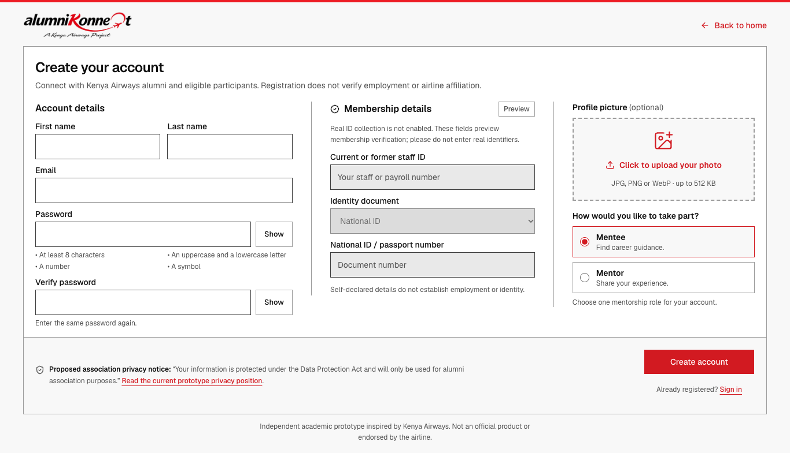
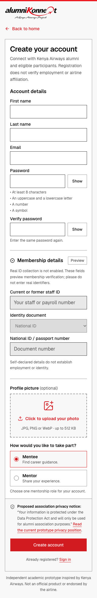

# Registration and private profile-photo acceptance (#36)

Verified on 5 November 2026 against merged application baseline `8fc0a86` (GitHub
main after PRs #38, #57, #58 and #59). The acceptance run found and fixed stale photo display after replacement: rapid
same-path uploads can receive the same signed URL, so the rendered URL now carries
the Storage object version in its query string. This milestone also adds repeatable browser/
integration checks, isolated-stack tooling and retained visual evidence.

## Acceptance matrix

| Issue #36 criterion | Observed evidence |
| --- | --- |
| Desktop width, narrow mobile and keyboard | Headless Chrome 157.0.8103.38 with Playwright 1.64.1 at 320, 375, 768, 1366 and 1440px; no horizontal page overflow; stacked mobile names, paired desktop names and card width over 1100px. Submit reachable; Tab order, password visibility, input focus ring and keyboard file-picker activation passed. |
| First/last names and compatibility | Actual signup preserved normalized first/last Auth metadata and combined `Test Member` profile name/role. A legacy fixture containing only `full_name` retained `Legacy Member` through sign-in and Storage permission tests. |
| Client/server password checks | Browser weak-password/exact-confirmation feedback and focus passed. Direct real Next Server Action POSTs independently rejected weak passwords, a trailing-space confirmation mismatch and spoofed image bytes without creating an account. |
| Optional photo preview, persistence, replacement and retry | Real PNG preview; client type/size errors; real signup upload; reload and authenticated download; replacement bytes and visible rendered image changed. A deliberately restricted disposable bucket caused a real upload failure: account/profile/session survived, retry message appeared, original bucket settings were restored and retry saved the photo. Signup without a photo passed. |
| Private Storage permissions | Actual anonymous download/upload/public-endpoint access denied. Another authenticated user's insert/upsert at the owner's avatar path denied; arbitrary owner path denied. Rejected writes preserved saved bytes. Owner download and fixed-path replacement succeeded. |
| Confirmation disabled and enabled | Disabled: immediate session/photo save and separate no-photo signup passed. Enabled: no session/photo before confirmation, check-email/reselect instructions, actual Mailpit delivery, actual Supabase confirmation link, password login and authenticated photo reselection/save passed. |
| Separate local/runtime/deployment evidence | This record distinguishes actual local browser/Auth/Storage results, automated unit checks, existing merged implementation and remaining hosted release requirements below. |

The two modes passed 7 and 5 top-level acceptance groups respectively. All fixtures
were synthetic `example.test` identities in the **dedicated disposable project**;
each run removed its accounts and avatars and verified the original isolated
account baseline was restored. No real member email, production write or external
mail send was needed. Screenshots contain only the empty registration form.

## Visual evidence

Desktop, 1366 × 768 viewport (full page capture):



Mobile, 320 × 844 viewport (full page capture):



Both were visually inspected for clipping, readable controls, column/stack behavior
and access to the photo picker, role choices and submit action. Intermediate widths
were checked by the browser suite. These are desktop browser viewport checks, not
physical-device or current native-Safari acceptance claims. Earlier native Safari
observations remain in `registration-privacy-assessment.md` and issue history.

## Behavior and security contract

- Registration retains the approved identity-preview section: real ID collection
  stays disabled and rejected server-side. This work changes no affiliation policy.
- First/last names are required; existing combined profile names remain supported.
  Passwords require eight characters, uppercase/lowercase letters, a number and a
  symbol; exact confirmation is checked in the browser and Server Action.
- Optional JPG/PNG/WebP files are limited to 512 KiB. Browser checks handle type/size;
  server checks also validate file signatures before signup/upload.
- The private `profile-photos` bucket permits authenticated members to read photos.
  Insert/update are limited to `${auth.uid()}/avatar`; no anonymous access is granted.
  Issued signed URLs are bearer links valid for five minutes: do not publish them.
- Confirmation-required signup cannot upload before a session exists. The selected
  file is intentionally not retained; after confirming and signing in, reselect it
  at `/profile/photo`. Full resend/recovery and email delivery remain #15/#34.
- A failed optional upload never discards the newly created account; it redirects
  to `/profile/photo?retry=1`. Replacement uses the same owner path and cache age 0.

Migration: `supabase/migrations/20261104150232_signup_profile_photos.sql`.
The current disposable test project applied all migrations from the merged baseline,
including the later privacy migration. No new schema/policy change was needed.

## Reproduce safely

Requirements: Node compatible with the project, Docker, the locked npm dependencies
(`npm ci`) and installed Google Chrome. The test uses a separate headless Chrome
profile; it never attaches to the user's normal browser. To use another compatible
browser executable, export `REGISTRATION_BROWSER_EXECUTABLE` before starting the
helper. The helper writes that path into the private test environment.

The helper fixes project ID `alumnikonneqt-issue36`, API/DB/mail ports
56321/56322/56324 and app port 3110. It copies migrations/templates to
`/private/tmp/alumnikonneqt-issue36`, disables seeds and Google, and uses the local
mail sink. It never resets or links a production/existing development project.
Ensure these ports are unused. Never put production SMTP overrides in its shell.

```sh
node scripts/registration-test-stack.mjs prepare
node scripts/registration-test-stack.mjs start
node scripts/registration-test-stack.mjs build
node scripts/registration-test-stack.mjs serve
```

Leave that app process running; in another terminal:

```sh
node scripts/registration-test-stack.mjs test
node scripts/registration-test-stack.mjs confirmations-on
node scripts/registration-test-stack.mjs test
node scripts/registration-test-stack.mjs stop
```

Stop the app process afterward. The helper stops only its named project and retains
its disposable volumes; it never uses `db reset`, `stop --all` or `--no-backup`.
The environment file and command/failure logs are private temporary files and must
not be committed or pasted into issues. The runner prints only sanitized check
labels, browser version and fixture counts. Mailpit and older Inbucket APIs are
supported. SMTP acceptance is verified by retrieving the fixture's actual message
and following its confirmation link locally; tokens never enter test output.

`npm run test:registration` invokes the same runner when the required local-only
environment is already loaded. If the local browser library is installed outside
normal node resolution, `REGISTRATION_PLAYWRIGHT_PATH` can point to its entry file.
The captured run used the locked Playwright version from a temporary tools install
so the other checkout's shared dependencies were not modified.

## Verification levels and remaining release requirements

- **Application source:** the main feature was already merged. A new local fix
  versions the photo URL by the Storage object version so replacement updates
  the visible image without introducing an impure render timestamp.
  The real browser regression first failed on stale displayed pixels despite
  correct stored bytes, then passed after the correction.
- **Local static/unit:** full ESLint and TypeScript passed; all 100 Node tests passed.
- **Production build:** Next.js 16.4.5 Webpack build passed against the isolated local
  backend, including route generation. No hosted deployment was performed.
- **Local real runtime:** browser plus real Supabase Auth/Postgres/private Storage,
  local email delivery/confirmation, permissions, upload-failure recovery and cleanup
  passed as described above. The initial confirmation test used the obsolete
  Inbucket endpoint; the harness was corrected for the actual Mailpit service and
  the full confirmation run passed. That was a test-harness failure, not a mail outage.
- **Hosted release (#8):** confirm the photo migration and bucket settings exist on
  the intended hosted project; deploy the reviewed merged source and verify permitted
  hosted signup/photo workflows. Match actual confirmation/SMTP configuration to
  #15/#34. Do not weaken confirmation or enable public Storage to make uploads work.
- **Assessment/participant study:** physical-device, broader assistive-technology
  and representative-user evidence remain their separate acceptance work. No such
  evidence is claimed here. The new photo-refresh fix and acceptance tooling/evidence
  commit are local until separately authorized for push. Keep #36 open while the
  discovered correction is unmerged; this record does not claim a published fix.

This verifies #36's specifically scoped registration/photo criteria locally. #15 owns
the complete verification/resend/recovery journey, #34 hosted sender delivery and
#8 overall hosted release acceptance; none is closed by this record.
